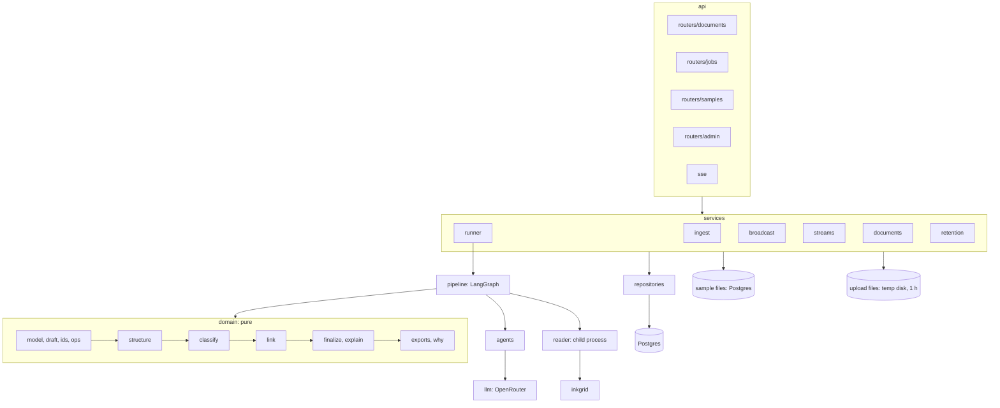

# Architecture

- **Pipeline.** One LangGraph state graph; nodes are thin shells over the domain and stream `stage`,
  `delta` and `llm` events. Agent stages skip with a reason (`disabled`, `budget`, `no_input`).
- **Runner.** Claims jobs with `FOR UPDATE SKIP LOCKED`, persists each event before broadcasting it,
  writes the graph, blobs and the `done` event in one transaction.
- **Streams.** Subscribe first, replay the persisted log, then forward live events, dropping any id
  already sent; `Last-Event-ID` resumes.
- **Determinism.** Content-derived ids, a canonical-JSON graph hash, recorded model answers; run facts
  (timings, request counts) live on the job, not in the graph.

The design and every behaviour, with its test cases, are in [`specs/`](specs/00-design.md).
