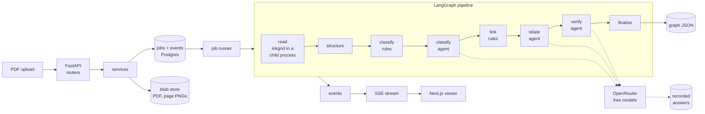

# inkthread: design

inkthread turns a born-digital PDF into a knowledge graph of the document itself. Every section,
paragraph, list item, table, note, defined term and outside citation becomes a node. Every way one part
depends on another becomes a typed, directed edge: it contains, continues, cites a note, defines,
uses a term, refers to, cites an outside source, governs, qualifies, overrides or illustrates. Node
text is verbatim from the page. Every node maps to its page region. Every edge carries the span of text
that licenses it and names the rule or agent that made it.

This file is the product design. The numbered specs beside it hold each part's behaviour and its
enumerated test cases:

| spec | covers |
|---|---|
| [01-graph-contract.md](01-graph-contract.md) | the `inkthread.graph/1` model: nodes, edges, ids, enums, invariants |
| [02-structure.md](02-structure.md) | reading inkgrid's output: set-aside, section tree, parts, tables, notes, continuation |
| [03-classify.md](03-classify.md) | the role taxonomy and the deterministic role rules |
| [04-link.md](04-link.md) | the deterministic resolvers: terms, references, citations, precedence, lead-ins |
| [05-agents.md](05-agents.md) | the LLM agents: tasks, contracts, grounding, budget, cache, cascade, verifier |
| [06-confidence-provenance.md](06-confidence-provenance.md) | reasons, tiers, the op log, the explain gate, the graph hash |
| [07-api-events.md](07-api-events.md) | the HTTP API, the SSE event stream, errors and limits |
| [08-persistence-jobs.md](08-persistence-jobs.md) | tables, blobs, the job runner, the reader process, retention |
| [09-exports.md](09-exports.md) | JSON-LD, GraphML and Cypher exports |
| [10-ops.md](10-ops.md) | configuration, health, deployment, CI |
| [12-platform-token.md](12-platform-token.md) | platform contract v2: who may call, and how a token is checked |
| [11-reading.md](11-reading.md) | inkgrid's tables and verification summary, kept per document; samples replay |

## 1. Where it comes from

inkthread is Part 2 of the FeeLedger split. Part 1 is [inkgrid](https://github.com/Abdul-Muizz1310/inkgrid),
the text-layer PDF reader. FeeLedger pre-processed stock-exchange fee schedules: it classified chunks,
attached the context each one needed and linked their relationships. inkthread keeps that relationship
model, drops the fee vocabulary, and makes the relationships themselves the product.

**Carried over from FeeLedger as binding rules** (its rulings and non-negotiables, generalised):

| rule | here |
|---|---|
| Agents emit structure, never text (N-8, D-11) | Model answers are ids, closed-vocabulary labels and quotes. A quote is only accepted when it snaps to a verbatim span of the page text; the span is stored, the model's string is not |
| Values only as printed (R-1) | No value is normalised, converted, inferred or restated. Text reaches a node only from inkgrid's reading |
| Nothing is withheld; mark what is missing (R-2, R-3) | Every inkgrid block ends in a node or in `set_aside`. A call with no note, a reference with no target, a table with no header: each ships on its node as a flag |
| A wrong edge is worse than none (B-12, B-8) | Resolvers abstain when evidence is ambiguous. An ambiguous reference ships as unresolved with its candidates, never as a guess |
| External only when the text says so (B-10) | A citation becomes an `external` node only when its own words name another document |
| Config is geometry only (N-7) | No document-specific rules. Thresholds that read the page live in code with tests |
| The verifier differs from the producer (R-8, D-l) | The model that checks agent claims is a different slug from the one that made them, compared on the slug that actually served |
| Results must be visible (R-12) | The frontend is the inspector: the page beside the graph, every node's region drawn on it |

**Not carried over:** the fee taxonomy, venues, editions and lineage, the vision reader, the
per-chunk adversary (13,354 calls for four documents), the judgement graph (rules, verdicts,
counterexamples), and the file-based harness. Section 11 lists what that leaves out.

## 2. Guarantees

Each guarantee is a test (named in the spec that owns it) and a check that runs on every graph before
it is stored (`finalize`, spec 06).

| # | guarantee | checked by |
|---|---|---|
| G1 | **Verbatim.** Every `text` of a section, paragraph, list item, table, note or definition node equals inkgrid's text for the blocks it came from, joined by `"\n"` when a heading spans two blocks. A term's or citation's `text` is a span of a part node's text | `explain` check X1 |
| G2 | **Grounded.** Every evidence span satisfies `node.text[start:end] == quote`. Every part node has at least one page region | X2, X3 |
| G3 | **Attributed.** Every node, edge and role assignment names its maker: `inkgrid`, a rule id, or an agent task with its model and request key. Every one of them has an op in the log | X4 |
| G4 | **Partitioned.** Every inkgrid block is cited by exactly one node or exactly one `set_aside` entry | X5 |
| G5 | **Honest gaps.** Every footnote call, section reference and table header that did not resolve is listed on its node as a flag. Nothing unresolved disappears | X6 |
| G6 | **Closed vocabulary.** Every kind, role, edge type, flag and reason is from the enums in spec 01; the graph model rejects anything else at construction | Pydantic |
| G7 | **Replayable.** The same PDF, pipeline version and recorded model answers produce a byte-identical graph (same `graph_hash`) with zero model calls | replay test |

## 3. Architecture

**Layers** (the house rule: routers → services → repositories → models; services never import
FastAPI; routers never import models):

| package | owns | must not |
|---|---|---|
| `inkthread.domain` | the pure core: graph model, ids, text spans, set-aside, sections, roles, resolvers, confidence, ops, exports | do I/O, import FastAPI, SQLAlchemy, httpx or LangGraph |
| `inkthread.pipeline` | the LangGraph state graph: nodes are thin shells over `domain` and the ports | write to the database |
| `inkthread.agents` | LLM task contracts, prompts as files, grounding of answers | call the network directly (it goes through `llm`) |
| `inkthread.llm` | the OpenRouter client, cascade, budget, request keys, the recorded-answer store port | know about tasks or graph types |
| `inkthread.reader` | the child-process boundary around inkgrid and page rendering | be imported by `domain` |
| `inkthread.services` | use cases: ingest, run a job, read a graph, export, retention | import FastAPI |
| `inkthread.repositories` | SQL through SQLAlchemy | hold business rules |
| `inkthread.models` | ORM tables | know about HTTP |
| `inkthread.schemas` | API DTOs | — |
| `inkthread.api` | routers, dependencies, SSE | touch the database directly |
| `inkthread.storage` | the blob store port and its local and R2 adapters | — |
| `inkthread.core` | config, database engine, errors, logging, rate limiting | — |
| `inkthread.platform` | `/health`, `/version`, `/metrics`, request ids, CORS | — |

A test on the import graph enforces the first column's "must not" (spec 10, T-OPS-1).

## 4. The pipeline in one table

| stage | kind | in | out | events |
|---|---|---|---|---|
| `read` | child process | PDF bytes | inkgrid `Document`, verification report, page PNGs | `stage` |
| `structure` | pure | the reading | set-aside, section tree, part nodes, `contains`, `continues`, `cites_note`, table cell labels, flags | `stage`, `delta` |
| `classify_rules` | pure | parts | role assignments with evidence; the residual | `stage`, `delta` |
| `classify_agent` | LLM, producer | the residual, batched | more role assignments (semantic) | `stage`, `llm`, `delta` |
| `link_rules` | pure | parts, sections | terms, `defines`, `uses_term`, `refers_to`, `cites_external`, explicit `overrides`/`qualifies`, lead-in `governs` | `stage`, `delta` |
| `relate_agent` | LLM, producer | role-bearing parts with no target, plus candidate windows | semantic `governs`, `qualifies`, `illustrates`, `overrides` | `stage`, `llm`, `delta` |
| `verify_agent` | LLM, verifier | the weakest semantic claims, bounded | verdicts: supported, unsupported, abstain | `stage`, `llm`, `delta` |
| `finalize` | pure | the draft | tiers, stats, the op chain, the explain gate, the graph hash | `stage`, `done` |

An agent stage is skipped, never failed, when it has no input, when the day's model budget is spent,
or when every model in the cascade fails. A skipped stage records why on the job and on each element it
would have judged (`model_unavailable`). The rules-only graph always ships.

## 5. Decisions made here

- **D-1. Structure first, models on the residual.** The deterministic layer builds most of the graph.
  On today's free models a call can return a 502, nothing, or empty labels (measured 2026-10-14), and the
  account allows 50 free requests a day for the whole portfolio. Rejected: GraphRAG-style triple
  extraction from token chunks. It loses sections, tables and footnotes, grounds at chunk level at best,
  and needs one call per chunk.
- **D-2. About eight model calls per document.** Classify at most 3 batches, relate at most 3, verify
  at most 2. Batches carry many parts each. Every answer is stored by its request key, so a re-upload or
  a replay calls nothing.
- **D-3. Grounding over trust.** A model claim enters the graph only when every quote it gives snaps
  to a verbatim span and every id it names was offered to it. Claims that fail are dropped from the
  graph and listed in `provenance.rejected` with the reason.
- **D-4. The verifier advises.** A verifier's `unsupported` marks the claim contested (tier D) and
  keeps it, flagged. FeeLedger's adversary was right 40–58% of the time, so it may demote but never
  delete.
- **D-5. No LangGraph checkpointer.** A job takes seconds to minutes. A crashed job re-runs from the
  start, and the recorded answers make the re-run free. The job row and its event log are the durable
  state.
- **D-6. inkgrid runs in a child process.** PyMuPDF and inkgrid change process-global state and are
  not thread-safe. A spawned single-worker pool with `max_tasks_per_child=1` reads one PDF at a time,
  under a timeout.
- **D-7. Page images, not the PDF, in the browser.** The reader renders each page to PNG once. The
  viewer draws node regions over the image. Shipping PDF.js would add a worker, a CSP exception and a
  second text layer that could disagree with inkgrid's.
- **D-8. Unversioned routes.** The portfolio has no `/v1` anywhere; the graph contract carries its own
  version (`inkthread.graph/1`).

## 6. Limits

| limit | default | why |
|---|---|---|
| upload size | 15 MB | Render's free instance has 512 MB of memory |
| pages | 40 | inkgrid reads 0.2–2 s a page on a laptop; the free instance is far slower |
| jobs at once | 1 | one child process; others queue |
| queue length | 10 | beyond it, `503 queue_full` |
| uploads per caller | 5 an hour | the model budget is shared; per bastion subject, else per client address (spec 12) |
| model calls | 8 per document, and a daily cap below the account's 50 | the free tier |
| retention | uploads processed, not kept: the PDF goes when its job ends, the results after an hour; samples kept | privacy and storage |

## 7. Privacy

Document text goes to OpenRouter's free models, whose providers may log prompts. The upload page says
so, the README says so, and uploads are processed, not kept: the PDF is deleted when its job ends, and
the graph and page images an hour later. Words that inkgrid marks hidden
(render mode 3, alpha 0) are never sent to a model: a hidden "ignore previous instructions" stays out of
every prompt. The node keeps its verbatim text and is flagged `hidden_text`.

## 8. What the user sees

The frontend has its own design (`inkthread-frontend/docs/specs/`). In short: an upload page, a live
view where the graph grows as the stages run, and a workspace with linked panes (outline, 3D/2D graph,
page image with highlighted regions, and an inspector that shows each relationship's quote and maker).

## 9. Out of scope for v1

- Scanned PDFs: inkgrid has no OCR. A page with no text layer is reported, not read.
- Entity extraction (people, organisations, amounts, dates) and `mentions` edges. Deferred by the owner.
- DOCX, HTML and images.
- Cross-document graphs and editions.
- User corrections and accounts.

## 10. Risks

| risk | handling |
|---|---|
| Free models drift or vanish (the portfolio's three configured slugs did) | slugs are configuration; a capability smoke call records whether each one returns valid structured output; a failed cascade skips the stage |
| The free instance is too slow or too small for inkgrid | page cap, timeout, child process; the samples are processed ahead of time |
| Rules over-link (a common word defined as a term) | single-word terms match only as printed (case-sensitive); the viewer hides `uses_term` by default above a threshold |
| PyMuPDF is AGPL | the backend is public on GitHub (MIT) and the frontend links to its source, which meets the AGPL's network clause for the combined work |

## 11. Left out of FeeLedger, and why

| left out | why |
|---|---|
| Block C's ADE-vs-page checks | inkgrid's text is the page's text layer; its PDFium verifier already re-reads every character |
| The per-chunk adversary and probes | thousands of calls per document against a 50-a-day budget |
| Rules, verdicts, counterexamples, lineage | they pay off over a recurring corpus with a reviewer, not over one-off uploads |
| Hard-linked run folders, the agent queue and drain | database rows and one job queue do the same job here |
